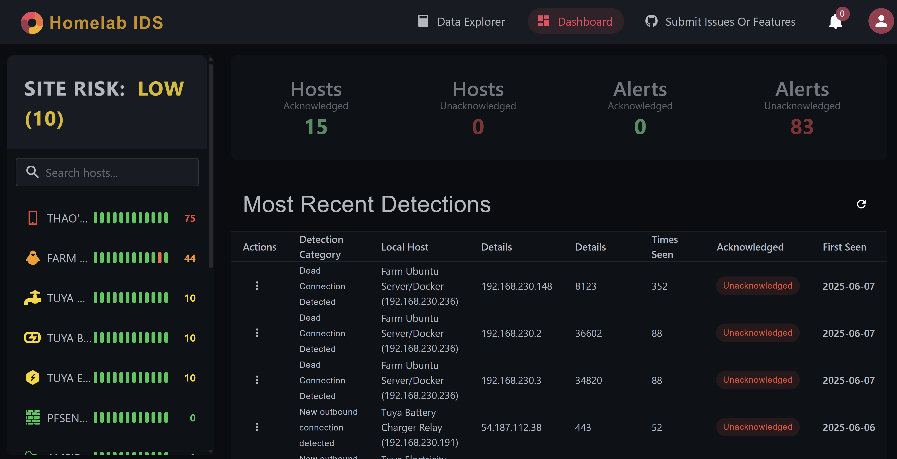
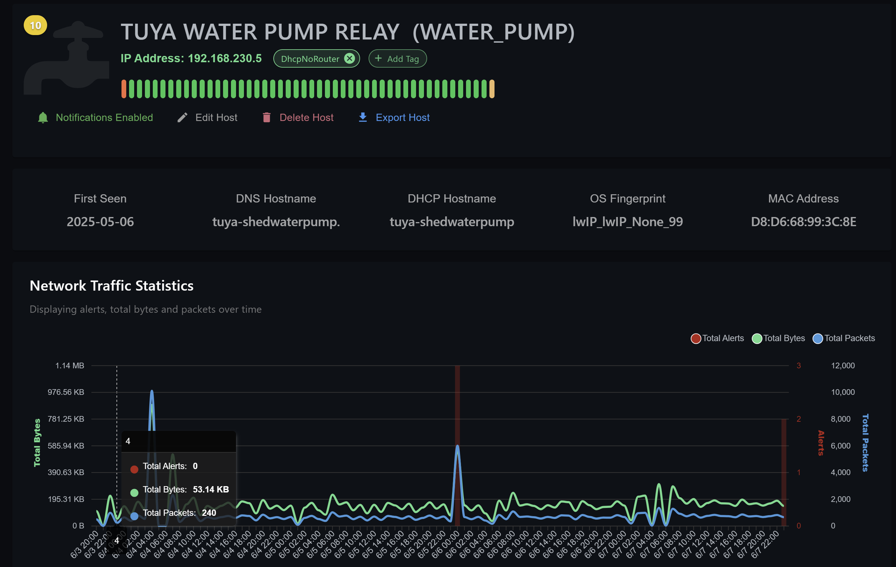
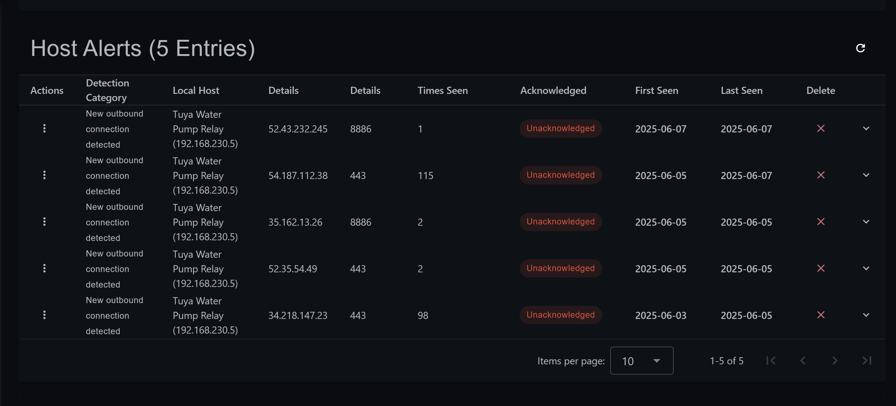
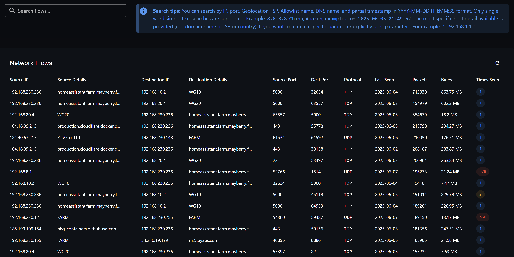
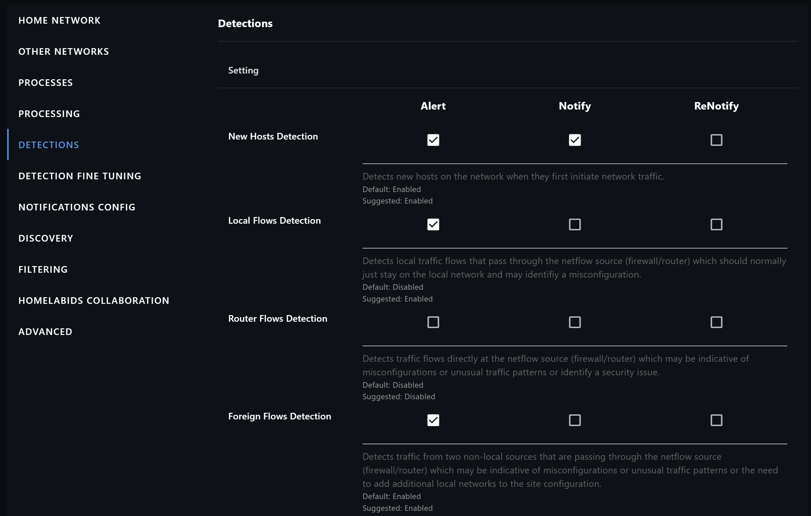

<p align="center">
  
</p>

# Sando - Know your network

**Sando** is a lightweight, customizable, and powerful **network monitoring solution**. Sando helps you inventory the devices on your network, monitor, detect, and respond to suspicious activity in your network with ease.

It helps answer:

- What hosts are on my network?
- What internet destinations are they connecting to?
- What DNS lookups are they doing?
- Which flows, hosts, countries, ports, or services are they talking to?

Videos:

- [30 second intro](https://www.youtube.com/watch?v=6P8XtUhSUis)
- [What is Sando?](https://www.youtube.com/watch?v=2rwY5qXNQjk)

---

## 🌟 **Features**

### 🔍 **Network Host Inventorying**
- Integrated DHCP Server **won't respond to unknown hosts**.
- DHCP Relay support **supports multiple VLANs** from one DHCP Server.
- Maintains **network host inventory** and **easily classify hosts on your network**.

### 🔍 **Network Flow Monitoring**
- Detect **new hosts** joining your network.
- Monitor **local, router, and foreign flows**.
- Identify **new outbound connections** and **high-bandwidth flows**.

### 🌍 **Geolocation and Reputation**
- Detect traffic to **banned countries**.
- Integrate with **reputation lists** to detect malicious IPs.
- Detect traffic bypassing **local DNS** or **NTP servers**.

### 📊 **Real-Time Alerts**
- Get instant alerts via **Telegram** for critical events.
- Log all detections in a centralized database for easy analysis.

### 🛠️ **Customizable Configurations**
- Fine-tune detection thresholds and approved lists.
- Enable or disable specific detection mechanisms.
- Integrate with **Pi-hole** and **AdGuard** for DNS query monitoring.

### 📊 **Integrations**
- Works with Home Assistant and Homepage.dev dashboard and potentially more
- Works with Pihole and PfSense, OPNSense
- Works with various reputation and geolist providers like MaxMind, IPASN, Tor list, etc

### ⚡ **Lightweight and Efficient**
- Designed to run on minimal hardware.
- Perfect for Raspberry Pi, home servers, or virtual machines.

---

## 🎯 **Why Choose Sando?**

- **Simple Setup**: Easy to install and configure.
- **Customizable**: Tailor the system to your specific needs.
- **Open Source**: Fully transparent and community-driven.

---

## 🚀 **Get Started Today!**

Take control of your home network with **Sando**. Start monitoring, detecting, and protecting your network today!


---

## Recent Updates

Recent backend and dashboard updates include:

- Discord notifications: Sando can now send alerts through Discord webhooks in addition to Telegram. See [sando#11](https://github.com/mayberryjp/sando/issues/11) and [sando-website#1](https://github.com/mayberryjp/sando-website/issues/1).
- Safer configuration UI: sensitive settings are obscured by default in the dashboard and can be temporarily revealed with a show/hide control. This covers Telegram, Discord, Pi-hole, AdGuard, and MaxMind secrets. See [sando-website#5](https://github.com/mayberryjp/sando-website/issues/5).
- Firewall interface metadata: host/network data can store firewall interface names when that information is available. See [sando#32](https://github.com/mayberryjp/sando/issues/32).
- Performance database maintenance: `dbperformance` records older than 180 days are removed at backend startup. See [sando#31](https://github.com/mayberryjp/sando/issues/31).
- Troubleshooting note: if the Sando host/container itself is not appearing in traffic or alerts, make sure the server network is included in `LocalNetworks`. See [sando#7](https://github.com/mayberryjp/sando/issues/7).

---

## Architecture

Sando is split into two containers:

- `sando`: Python backend. Runs the NetFlow and IPFIX collectors, API, detections, integrations, discovery, watchdog, optional DHCP server, optional sinkhole DNS server, and MCP server.
- `sando-website`: Vue 3/Vite frontend. Serves the dashboard on port `3030` and calls the backend API.

Data flow:

```text
Firewall/router NetFlow v5 -> UDP/2055 -> sando collector
Firewall/router IPFIX v10 -> UDP/4739 -> sando ipfix
Both collectors -> shared tagging, flow/host statistics and SQLite databases
                -> detection processor -> API on TCP/8044
                                       -> dashboard on TCP/3030
```

The backend is managed with supervisord and starts multiple processes. Most detections and optional services are controlled by settings and can be enabled or disabled from the dashboard.

---

## Ports

| Service | Port | Required | Notes |
| --- | --- | --- | --- |
| Dashboard | TCP/3030 | Yes | Served by `sando-website` |
| Local API | TCP/8044 | Yes | Served by `sando` |
| NetFlow v5 collector | UDP/2055 | Yes | Configure your firewall/router to export here |
| IPFIX v10 collector | UDP/4739 | Yes, when exporting IPFIX | Runs alongside NetFlow; supports IPv4 and IPv6 flow records |
| Sinkhole DNS | TCP/UDP 53 | Optional | Only if `SinkHoleDns` is enabled |
| DHCP server | UDP/67 | Optional | Only if `DhcpServer` is enabled |
| MCP server | TCP/8030 | Optional/experimental | Local MCP endpoint |

Do not expose these ports directly to the internet.

### Alert history and pagination

`GET /api/alerts/recent` returns all stored alerts by default, allowing the
dashboard to paginate locally without a backend result cap. The response remains
a JSON array with the existing alert fields.

Clients can optionally request a slice with
`GET /api/alerts/recent?limit=50&offset=100`. `limit` is the maximum row count;
`offset` is the number of rows to skip (default `0`). Omitting `limit` returns
all remaining rows, and `limit=0` returns an empty array. Both parameters must be
non-negative integers; invalid values return HTTP `400`.

Results are ordered by `first_seen` descending, then `id` descending for stable
ordering when timestamps match. Offset-based pages may shift if alerts are
inserted or deleted between requests.

### Structured DHCP history

`GET /api/dhcp/logs` returns structured DHCP server events in a JSON object:

```json
{
  "logs": [{
    "id": 42,
    "timestamp": "2026-11-23T10:03:27.123+09:00",
    "interface": "VLAN30",
    "event": "reply_sent",
    "dhcp_message": "ACK",
    "peer": "10.2.30.1:67",
    "transaction_id": "0e5c33f4",
    "client_mac": "98:17:3C:A6:86:28",
    "reason": null,
    "details": {}
  }],
  "total": 1,
  "limit": null,
  "offset": 0
}
```

History is persisted in `/database/dhcplogs.db` and retained for **seven days**.
Expired entries are removed when events are written or history is retrieved,
and by the watchdog's 60-second maintenance loop even when DHCP is idle or
disabled. The collector initializes this
database on startup for both new and existing installations.

Optional exact-match filters are `client_mac`, `event`, `transaction_id`, and
`interface`; combine them with `&`. MAC addresses and eight-digit hexadecimal
transaction IDs are case-insensitive. For example:

```text
GET /api/dhcp/logs?client_mac=98:17:3C:A6:86:28&event=reply_sent&limit=50&offset=0
```

Without `limit`, all retained matching events are returned. `limit` and `offset`
must be non-negative integers within SQLite's signed 64-bit range; `limit=0`
returns no rows. `total` counts matching events before pagination. Invalid
queries return HTTP `400`, and database failures return `500` rather than an
empty success response. Results are newest first, then descending `id` for
timestamp ties; offset pages may shift as new events arrive.

Events are `worker_started`, `worker_stopped`, `worker_failed`,
`request_received`, `reply_received`, `reply_sent`, `request_ignored`,
`packet_dropped`, `send_failed`, and `processing_error`. Reasons explain passive
monitoring, unknown clients, scope mismatches, NAKs, malformed packets, and
failures. DHCP names include Discover, Offer, Request, ACK, NAK, Release,
Decline, and Inform. `details` contains parsed packet fields (including relay,
client, and offered IPs), raw DHCP options keyed by option number with
hexadecimal values, decoded hostname/requested IP, and lease time in seconds.
Worker events instead include listen/server configuration.

Timestamps include the backend's local UTC offset; a frontend can render them
in Asia/Tokyo or another selected timezone. `interface` comes from the matching
`LocalNetworks` scope's `firewall_interface_name`, or is `null` when unknown.
Other unavailable fields are also `null`, not fabricated values. Sando is a
server receiving requests via relays, so it records replies **sent**, not
Modan-style forwarding hops it cannot observe. Logging does not change lease
decisions, and persistence failures are reported without preventing replies.
This endpoint supplies backend data only; a dashboard table is not included.

### Docker container hosts

Device classifications use the existing `icon` field. Set `icon` to
`DOCKER_CONTAINER` (`DOCKER CONTAINER` is also accepted and normalized).
`PUT /api/localhosts/<ip_address>` accepts an optional `docker_host`: the
`ip_address` of an existing local device classified as `LINUX_SERVER` or
`WINDOWS_SERVER`, not free-form text. For example:

```json
{
  "icon": "DOCKER_CONTAINER",
  "local_description": "Application container",
  "docker_host": "192.168.1.10"
}
```

Populate the optional Docker host dropdown from
`GET /api/localhosts/docker-hosts`. It returns an array of
`{"ip_address": "...", "local_description": "...", "icon": "LINUX_SERVER"}`
objects (including Windows servers), or `[]` if none are eligible.
Only show this dropdown for containers; use the IP as its submitted value
and the description/IP as its label.

Host list/detail responses include nullable `docker_host`. Omit it on update
to preserve a container's current reference, or send `null` to clear it.
Switching a container to another classification clears its reference.
Deleting a referenced server or changing it to a non-server classification
clears dependent containers' references; changing its IP updates them.
Invalid references, self-references, or a non-null `docker_host` on a
non-container return HTTP `400` without changing the classification.
Unknown devices return `404`; database failures return `500`.
Schema version 23 adds the nullable column to existing installations.

### Connected network metadata

`GET /api/localhosts` and `GET /api/localhosts/<ip_address>` include two
top-level fields derived from the host's `ip_address` and `LocalNetworks`:

```json
{
  "ip_address": "10.1.10.2",
  "connected_interface_name": "server_vlan",
  "connected_network": "10.1.10.2/24"
}
```

The matching network's `firewall_interface_name` is lowercased; its `cidr`
is returned exactly as configured. CIDRs containing host bits are accepted.
For overlapping networks, the longest prefix wins; the first configured
entry wins ties. An unmatched host receives `null` for both fields; a
matched network without an interface name still returns its CIDR.
IPv4 and IPv6 host addresses are supported. Values are derived on each
read, not saved to the host table. Invalid network configuration or lookup
failures return HTTP `500` rather than claiming the host is unmatched.

### Available IP lookup

`GET /api/localhosts/available-ip?network=192.168.1.0%2F24` returns:

```json
{"ip_address": "192.168.1.2"}
```

Supply an IPv4 subnet in CIDR notation using the `network` query parameter.
Host bits are normalized (for example, `192.168.1.42/24` searches
`192.168.1.0/24`). The lowest usable address not present in the host inventory
or configured as a router in `LocalNetworks` is returned. Offline and
unclassified hosts still count as occupied. Network and broadcast addresses
are excluded for ordinary subnets; `/31` and `/32` use standard IPv4 host
semantics (two hosts and one host, respectively).

This is an inventory-only suggestion: no probing, saving, or reservation occurs.
Devices Sando has never seen may still use the address. Repeated or concurrent
requests can return the same address until the frontend saves an assignment.
Responses are not cacheable. Missing/invalid CIDRs and IPv6 return HTTP `400`,
exhausted subnets return `404`, and lookup failures return `500`.

---

## Security

Sando is currently intended for trusted private networks. Not all production security controls are implemented yet, including user authentication, API keys, TLS between the dashboard and API, and database encryption.

Recommended security posture:

- Run Sando only on a private LAN or management VLAN.
- Do not expose `3030`, `8044`, `8030`, `2055`, `4739`, `53`, or `67` to the internet.
- Use firewall rules to limit dashboard and API access to admin devices.
- Back up the `/database` volume because it contains Sando's persistent state.
- Review opt-in cloud/API settings before enabling them.
- The dashboard masks sensitive configuration values by default, including Telegram, Discord, Pi-hole, AdGuard, and MaxMind secrets.

---

## Installation

See `docker_config_examples/` for backend examples and `sando-website/docker_example_configs/` in the website repository for dashboard examples.

### Backend collector/API container

```yaml
version: "3"
services:
  sando:
    network_mode: host
    container_name: sando
    restart: "unless-stopped"
    image: mayberry4477/sando:latest
    volumes:
      - /docker/sando:/database
    environment:
      - SITE=FARM
      - TZ=Asia/Tokyo
```

`SITE` is the site name shown in Sando. `/database` is the persistent volume for configuration and all SQLite databases.

Timestamps returned by the API and MCP use the backend's local time, without
conversion to UTC or the client's timezone. Set `TZ` to your local timezone
(for example, `Asia/Tokyo`) in the backend container. Action timestamps use
`YYYY-MM-DD HH:MM:SS` without a timezone suffix. Existing records are left
unchanged, so actions saved by older versions may still contain UTC times.

### Dashboard container

```yaml
version: "3"
services:
  sando-website:
    network_mode: host
    container_name: sando-website
    restart: "unless-stopped"
    image: mayberry4477/sando-website:latest
    volumes:
      - /docker/sando-website:/database
    environment:
      - TZ=Asia/Tokyo
      - SANDO_API_BASE_URL=http://192.168.1.10:8044
```

`SANDO_API_BASE_URL` must be a URL that your browser can reach from your desktop, laptop, or mobile device. Use the IP address or hostname of the machine running the `sando` backend container.

After both containers are running, open:

```text
http://YOUR_SANDO_HOST:3030
```

### Published images vs local builds

Use the `mayberry4477/sando:latest` and `mayberry4477/sando-website:latest` images if you want to pull published containers.

---

## Initial Configuration

After first startup, configure your router/firewall to export NetFlow v5 to UDP port `2055`, IPFIX v10 to UDP port `4739`, or both to the backend container.

Then open the Sando dashboard and configure:

- Local networks, for example `192.168.1.0/24`.
- Router IP addresses, if you want router-flow detection.
- Processes and detections you want enabled.
- Notification integrations, if desired.
- Optional discovery, Pi-hole, AdGuard, DHCP, sinkhole DNS, reputation, ASN, Tor, or MaxMind integrations.

New host detection is enabled by default in the install configuration and is a good first detection to use while building a local inventory. Other detections can be enabled after you have tuned local networks, approved services, and ignore lists.

If you use Sando's DHCP server, it can work with DHCP relay across multiple VLANs or within one network. All relevant subnets must be configured as local networks.

---

## Configure IPFIX v10

Configure your exporter to send IPFIX **version 10 over UDP** to the backend host on port `4739`. NetFlow v9 is not IPFIX and is not accepted. Both collectors are enabled by default and run as separate supervisord processes (`collector` and `ipfix`), monitored by the watchdog.

- The NetFlow collector owns database/configuration initialization. IPFIX waits at least 30 seconds and checks the initialization marker and required tables before listening; it does not reinitialize databases or clear queued flows. Bootstrap still runs when `StartCollector` is disabled.
- `StartCollector` and `StartIpfixCollector` independently enable their respective listeners. Disabled processes remain alive for watchdog monitoring and recheck settings every 30 seconds. Restart the corresponding supervisor process after disabling an already-running listener.
- Override bindings with `COLLECTOR_LISTEN_ADDRESS` / `COLLECTOR_LISTEN_PORT` and `IPFIX_LISTEN_ADDRESS` / `IPFIX_LISTEN_PORT`. Ports default to `2055` and `4739`; do not give both listeners the same binding. An IPv6 transport binding such as `IPFIX_LISTEN_ADDRESS=::` is supported; IPv6 flow records can also arrive over IPv4 UDP transport.
- With bridge networking, publish both `2055:2055/udp` and `4739:4739/udp`. The host-network deployment example requires no additional port mappings.

IPFIX templates are cached separately for each exporter IP/source port and observation domain. Exporters must send templates before data and refresh them more often than every 30 minutes, including after collector restarts. The cache holds up to 4,096 templates; missing/expired templates and malformed messages are logged rather than stopping other exports. UDP template withdrawals are ignored per RFC 7011.

Flow templates must include source/destination IPv4 (`8`/`12`) or IPv6 (`27`/`28`) addresses, `protocolIdentifier` (`4`), `packetDeltaCount` (`2`), and `octetDeltaCount` (`1`). Transport ports (`7`/`11`) are optional and default to zero when absent. Netcontrol's ICMP type/code encoding is retained as the numeric destination-port value. Reduced-size integers, multiple records/sets, variable-length fields, and enterprise fields are supported; unknown/enterprise fields and options metadata are skipped. Total-counter-only templates are logged and not ingested. Export unsampled, delta-counter flows (`sampling_rate: 1` for Netcontrol). Unexpected sampled exports produce a warning; packet/octet counts remain observed values and are never multiplied. Counters larger than SQLite's signed 64-bit range are rejected with a log message.

IPv4 and IPv6 flows follow the same tagging, transient-flow upsert, host statistics, detection, historical-flow, traffic statistics, and Explore/API workflow. IPFIX `flowStartMilliseconds` / `flowEndMilliseconds` (IEs `152`/`153`) populate the existing `flow_start` / `flow_end` columns as local-time strings with millisecond precision. `last_seen` records receiver arrival time separately, not delayed batch-processing time. Without exported timestamps, flow times use receipt time as NetFlow does. Repeated segments retain the earliest start, latest end, and latest receipt through transient and historical aggregation. Inverted exported times are warned about, not silently corrected; timestamps outside the supported datetime range are rejected.

IPFIX is intentionally normalized into the existing NetFlow columns without a separate record model or schema migration. This is compatible ingestion for unsampled Netcontrol exports, **not full compliance with its lossless receiver specification**: TOS and exporter/session provenance are not stored in the five-tuple aggregation key; sampling metadata and sequence numbers are discarded; duplicates are not suppressed; missing context, ICMP/SCTP interpretation, counters and API number precision retain the legacy model's limitations. Use a trusted network and distinct monitored traffic to avoid ambiguous attribution or duplicate counting.

Add IPv6 CIDRs to `LocalNetworks` with `"ip_version": 6`. IPv6 multicast and link-local tags are supported; country, ASN and reputation lookups keep IPv4 and IPv6 ranges separate. MaxMind imports both block CSVs and ASN imports the combined IPv4/IPv6 dataset; refresh these integrations after upgrading to obtain IPv6 enrichment.

IPv6 range integers are stored losslessly as fixed-width `v6:` hexadecimal text in SQLite and decoded by database helpers; existing IPv4 storage is unchanged. Explore's IPv4 numeric index columns are `NULL` for IPv6, while address text columns remain searchable and enrichment is retained.

Both collectors use `CollectorProcessingInterval`, `WriteNewFlowsToCsv`, and the same tags/detections. When CSV output is enabled, NetFlow writes `/database/newflows.csv` and IPFIX writes `/database/ipfix_newflows.csv` to avoid competing headers. Shared totals are updated transactionally; `LastPackets`, `LastFlows`, and `LastBytes` sum the latest independent interval from each collector.

If both exporters report the same observed traffic, Sando adds both observations; it does not deduplicate across protocols. Avoid exporting the same traffic twice unless that is intentional.

## Configure NetFlow v5 on pfSense

Configuring NetFlow on pfSense is usually a two-step process.

First, install the `softflowd` package from:

```text
System -> Package Manager -> Available Packages
```

Search for `softflowd` and install it.

Second, go to:

```text
Services -> softflowd
```

Recommended settings:

- Enable softflowd: enabled
- Interface: LAN, plus any other interfaces you want to monitor
- Host: IP address of the machine running the `sando` backend container
- Port: `2055`
- Sample: `0`
- Max Flow: `8192`
- Hop Limit: unset
- NetFlow version: `5`
- Bidirectional Flow: unchecked
- Flow Tracking Level: full
- Flow Timestamp Precision: seconds
- Timeout General: `60`
- Other timeout settings: `60`
- MaxTimeout: `300`

Save the settings and confirm Sando starts receiving flows.

---

## Troubleshooting

Useful checks:

- Dashboard: `http://YOUR_SANDO_HOST:3030`
- API health: `http://YOUR_SANDO_HOST:8044/api/online/consolidated`
- Explore database health: `http://YOUR_SANDO_HOST:8044/api/online/explore`
- Confirm your firewall/router exports NetFlow v5 to `UDP/2055` or IPFIX v10 to `UDP/4739`.
- Confirm `SANDO_API_BASE_URL` points to a URL reachable from your browser.
- Check backend and dashboard container logs.
- Check for port conflicts before enabling sinkhole DNS on port `53` or DHCP on port `67`.
- If the Sando host/container itself is not showing traffic, confirm the server network is included in `LocalNetworks`.

Common symptoms:

- Dashboard loads but no data appears: check `SANDO_API_BASE_URL`, API health, and browser console errors.
- API is online but no flows appear: check the NetFlow/IPFIX target IP/port and firewall rules. For IPFIX, also check template refresh and missing-template logs.
- DNS sinkhole will not start: another DNS service may already be bound to port `53`.
- DHCP server will not work: another DHCP service may already own port `67`, or relay/local network settings may be incomplete.
- Multiple services exit immediately with status `0`, while DHCP/watchdog report a missing `insert_action` or sinkhole DNS reports a missing `insert_dns_queries_batch`: check for empty Python source modules. Commit `197c65e` accidentally emptied 37 modules. Use a corrected checkout or image, then rebuild/pull and recreate the backend container; restarting the same broken image will not fix it. Run `python -m pytest tests/test_process_startup.py` from the repository root to check source integrity and service imports without starting listeners.

Issues and feature requests can be submitted on GitHub.

### Conditional ignore-list polling

`GET /api/ignorelist` returns HTTP 200 with the existing JSON array (including
`[]` when empty) and a quoted `ETag` header. Send that header value back in
`If-None-Match` on subsequent polls. An unchanged policy returns HTTP 304 with
the same ETag and no body, without loading or serializing the list. A changed
policy returns HTTP 200 with the complete current array and its new ETag.
Weak validators and comma-separated validator lists are accepted, as is `*`.

The persistent revision uses random tokens updated by SQLite triggers in the
same transaction as every insert, update, or delete, including imports and bulk
cleanup. Normal collector startup installs this schema for existing databases.
Tokens survive restarts, and new changes after a database restore do not reuse
an incrementing revision number. The list and ETag are read from one database
snapshot. The `added` field uses the stored added/insert timestamp (or null for
legacy entries without either), not the request time.

### Ignore-list port values

`POST /api/ignorelist` accepts destination ports from `0` through `65535`,
including numeric `0` for recorded ICMP flows. Decimal integer strings are
normalized to integers; `"*"` still means any port. Missing, null, empty, or
invalid ports return HTTP 400. The protocol field is named `protocol`.
Frontends must preserve zero rather than converting it to an empty string or
wildcard. See the [frontend handoff spec](docs/frontend-ignorelist-port-zero.md)
for the request contract and acceptance tests.

### Cleaning up host allow rules

`DELETE /api/ignorelist/stale` removes allow rules with no tagged flow history,
rules whose tagged flows all have a null `last_seen`, and rules whose tagged flows
all have valid last-seen dates older than 30 days. Rules with recent activity,
mixed known/unknown dates, or invalid non-null dates are preserved. The response
includes `deleted_count`. Cleanup is requested explicitly, not run automatically.

---

## Configuration Reference

Configuration is stored in the `configuration` SQLite table and can be changed from the dashboard. The defaults below are based on the backend install configuration.

### Detection settings

| Key | Default | Description |
| --- | --- | --- |
| `NewHostsDetection` | `1` | Detect new hosts on the network. |
| `LocalFlowsDetection` | `0` | Detect local network flows. |
| `RouterFlowsDetection` | `0` | Detect flows involving configured router IPs. |
| `ForeignFlowsDetection` | `0` | Detect non-local or foreign flows. |
| `NewOutboundDetection` | `0` | Detect new outbound connections. |
| `GeolocationFlowsDetection` | `0` | Detect flows involving banned countries. |
| `BypassLocalDnsDetection` | `0` | Detect clients bypassing approved local DNS servers. |
| `IncorrectAuthoritativeDnsDetection` | `0` | Detect incorrect authoritative DNS behavior. |
| `BypassLocalNtpDetection` | `0` | Detect clients bypassing approved local NTP servers. |
| `IncorrectNtpStratrumDetection` | `0` | Detect incorrect NTP stratum behavior. |
| `DeadConnectionDetection` | `0` | Detect dead or stale connections. |
| `ReputationListDetection` | `0` | Detect traffic to reputation-list networks. |
| `VpnTrafficDetection` | `0` | Detect VPN traffic. |
| `HighRiskPortDetection` | `0` | Detect traffic involving high-risk ports. |
| `ManyDestinationsDetection` | `0` | Detect sources talking to many destinations. |
| `PortScanDetection` | `0` | Detect port scanning behavior. |
| `TorFlowDetection` | `0` | Detect traffic to known Tor nodes. |
| `HighBandwidthFlowDetection` | `0` | Detect high-packet or high-byte flows. |
| `RogueDhcpDetection` | `0` | Detect DHCP servers not in the approved list. |
| `AlertOnCustomTags` | `0` | Alert on flows matching configured custom tags. |

Note: the current backend configuration key is spelled `IncorrectNtpStratrumDetection`.

### Network and flow settings

| Key | Default | Description |
| --- | --- | --- |
| `LocalNetworks` | `[]` | Local network CIDRs. |
| `StartCollector` | `1` | Start the NetFlow collector. |
| `StartIpfixCollector` | `1` | Start the independent IPv4/IPv6 IPFIX v10 collector. |
| `ScheduleProcessor` | `1` | Enable scheduled flow processing. |
| `ProcessRunInterval` | `60` | Detection processor interval in seconds. |
| `CollectorProcessingInterval` | `60` | Processing interval in seconds for both flow collectors. |
| `ProcessingInterval` | `60` | General processing interval. |
| `CleanNewFlows` | `1` | Clean transient new-flow records after processing. |
| `RemoveBroadcastFlows` | `1` | Remove broadcast flows from processing. |
| `RemoveMulticastFlows` | `1` | Remove multicast flows from processing. |
| `RemoveLinkLocalFlows` | `1` | Remove link-local flows from processing. |
| `DnsResolverTimeout` | `3` | DNS resolver timeout. |
| `DnsResolverRetries` | `1` | DNS resolver retry count. |
| `MaxUniqueDestinations` | `30` | Threshold for many-destination detection. |
| `MaxPortsPerDestination` | `15` | Threshold for port-scan detection. |
| `HighRiskPorts` | `135,137,138,139,445,25,587,22,23,3389` | Ports treated as high risk. |
| `BandwidthAnomalyMuliplierThreshold` | `10` | Bandwidth anomaly multiplier threshold. |
| `MaxPackets` | `30000` | Packet threshold for high-bandwidth detection. |
| `MaxBytes` | `30000000` | Byte threshold for high-bandwidth detection. |
| `TrafficStatsPurgeIntervalDays` | `31` | Age in days before traffic stats are purged. |

The backend also removes `dbperformance` records older than 180 days at startup.

### Approved lists and tuning

| Key | Default | Description |
| --- | --- | --- |
| `ApprovedLocalNtpServersList` | empty | Approved local NTP servers. |
| `ApprovedLocalDnsServersList` | empty | Approved local DNS servers. |
| `ApprovedAuthoritativeDnsServersList` | empty | Approved authoritative DNS servers. |
| `ApprovedNtpStratumServersList` | empty | Approved NTP stratum servers. |
| `ApprovedVpnServersList` | empty | Approved VPN servers. |
| `ApprovedHighRiskDestinations` | empty | Destinations allowed for high-risk-port flows. |
| `ApprovedDhcpServersList` | empty | Approved DHCP servers for rogue DHCP detection. |
| `IgnoreListEntries` | `[]` | Ignore-list entries. |
| `TagEntries` | `[]` | Custom tag entries. |
| `AlertOnCustomTagList` | empty | Custom tags that should generate alerts. |

### Geolocation, reputation, ASN, and Tor

| Key | Default | Description |
| --- | --- | --- |
| `BannedCountryList` | `North Korea,Iran,Russia,Ukraine,Georgia,Armenia,Azerbaijan,Belarus,Syria,Venezuela,Cuba,Myanmar,Afghanistan` | Countries used by geolocation flow detection. |
| `MaxMindAPIKey` | empty | MaxMind API key, if used for geolocation data. |
| `ReputationUrl` | `https://iplists.firehol.org/files/firehol_level1.netset` | Reputation list URL. |
| `ReputationListRemove` | `192.168.0.0/16,0.0.0.0/8,224.0.0.0/3,169.254.0.0/16` | Networks removed from imported reputation lists. |
| `TorNodesUrl` | `https://www.dan.me.uk/torlist/?full` | Tor node list URL. |
| `ImportAsnDatabase` | `1` | Import IP-to-ASN data. |
| `ImportServicesList` | `1` | Import network service/port metadata. |
| `IntegrationFetchInterval` | `86400` | Integration fetch interval in seconds. |

### Discovery and DNS history

| Key | Default | Description |
| --- | --- | --- |
| `DiscoveryReverseDns` | `0` | Enable reverse DNS discovery. |
| `DiscoveryPiholeDhcp` | `0` | Import DHCP leases from Pi-hole. |
| `EnableLocalDiscoveryProcess` | `0` | Enable local discovery process. |
| `DiscoveryProcessRunInterval` | `28800` | Discovery run interval in seconds. |
| `DiscoveryNmapOsFingerprint` | `0` | Enable nmap OS fingerprinting. |
| `StorePiHoleDnsQueryHistory` | `0` | Store Pi-hole DNS query history. |
| `PiholeUrl` | empty | Pi-hole API URL. |
| `PiholeApiKey` | empty | Pi-hole API key. |
| `PiHoleDnsFetchRecordSize` | `10000` | Number of Pi-hole DNS records to fetch. |
| `PiHoleDnsFetchInterval` | `3600` | Pi-hole DNS fetch interval in seconds. |
| `PiholeFetchInterval` | `3600` | Shared DNS fetch interval in seconds for Pi-hole, AdGuard Home, and Miren. Also sets Miren's query lookback window. |
| `StoreAdGuardDnsQueryHistory` | `0` | Store AdGuard Home DNS query history. |
| `AdGuardUrl` | empty | AdGuard Home URL. |
| `AdGuardUsername` | empty | AdGuard Home username. |
| `AdGuardPassword` | empty | AdGuard Home password. |
| `StoreMirenDnsQueryHistory` | `0` | Store Miren DNS query history. |
| `MirenUrl` | empty | Miren API URL. |
| `DnsResponseLookupResolver` | empty | Resolver used to fill missing DNS response data. |
| `PerformDnsResponseLookupsForInvestigations` | `0` | Enable DNS response lookups for investigations. |

Some AdGuard keys may be created by the UI or integrations rather than seeded in the initial install configuration.

The obsolete `MirenFetchInterval` setting is removed at startup. Miren uses
`PiholeFetchInterval` (DNS Fetch Interval) instead, defaulting to 3600 seconds.

### Notifications

| Key | Default | Description |
| --- | --- | --- |
| `TelegramEnabled` | `0` | Enable Telegram notifications. |
| `TelegramBotToken` | empty | Telegram bot token. |
| `TelegramChatId` | empty | Telegram chat ID. |
| `DiscordEnabled` | `0` | Enable Discord webhook notifications. |
| `DiscordWebhookUrl` | empty | Discord webhook URL. |

Sensitive notification values are obscured by default in the dashboard configuration UI.

### Optional services

| Key | Default | Description |
| --- | --- | --- |
| `SinkHoleDns` | `0` | Enable sinkhole DNS server on port `53`. |
| `DhcpServer` | `0` | Enable Sando DHCP server on port `67`. |
| `DhcpPassiveMonitoring` | `0` | Enable passive DHCP monitoring. |

The sinkhole DNS server responds with `NXDOMAIN` and records queries. This can help profile or block selected IoT behavior, but it conflicts with other DNS services on port `53`.

### Cloud/API opt-in settings

| Key | Default | Description |
| --- | --- | --- |
| `SendConfigurationToCloudApi` | `0` | Send instance configuration to the Sando cloud API. |
| `SendErrorsToCloudApi` | `0` | Send error reports to the Sando cloud API. |
| `SendDeviceClassificationsToHomelabApi` | `0` | Upload device classifications. |

These settings are disabled by default. Review what each option sends before enabling it.

### System metadata

| Key | Default | Description |
| --- | --- | --- |
| `DatabaseSchemaVersion` | current backend schema version | Stored database schema version. |

---

## Screenshots

### Dashboard



### Host View



### Alerts



### Flow Explorer



### Settings Page



---

## Contributing

Contributions are welcome. Bug fixes, feature work, documentation improvements, and integration examples are all useful.

---

## License

Sando is licensed under the GNU Affero General Public License v3 (AGPLv3). See `LICENSE` for details.

---

## Community

- Reddit: [r/SandoSecurityAndDhcp](https://www.reddit.com/r/SandoSecurityAndDhcp/)
- YouTube: [@SandoSecurityAndDhcp](https://www.youtube.com/@SandoSecurityAndDhcp)
- GitHub: [mayberryjp/sando](https://github.com/mayberryjp/sando)

If Sando is useful, consider starring the project on GitHub.
